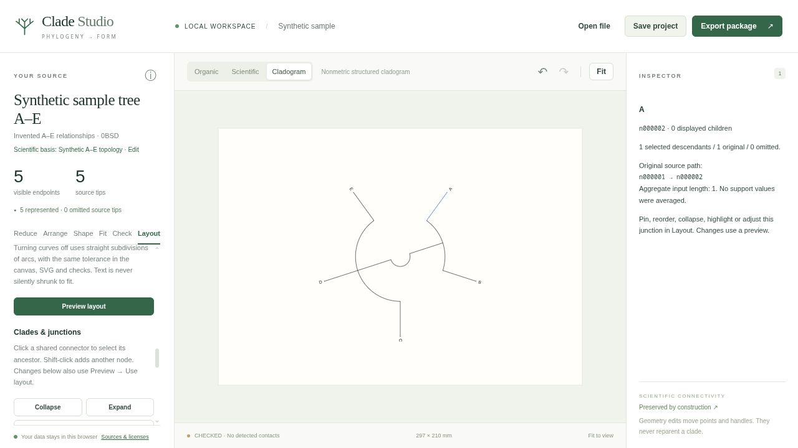
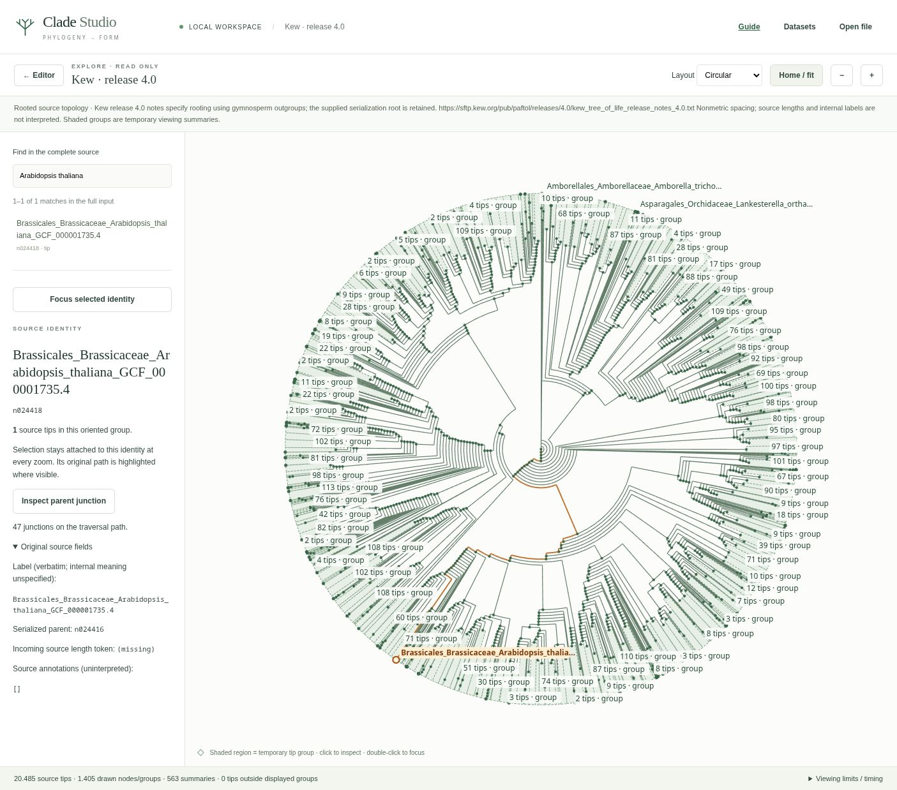

# Clade Studio

**Turn a tree into an editable, source-aware drawing.**

Clade Studio is a local browser app for designing phylogenetic trees and supplied classification hierarchies. Import a Newick tree, select organisms or groups, choose a layout, refine the drawing and export SVG artwork together with its sources and methods. It is designed for teachers and anyone preparing tree figures for their own materials.

The app runs on your computer, with no account, backend or file uploads. After installing the development tools and building, it works offline. Relationships come from your input: Clade Studio does not infer them or look up organisms online.



*The synthetic A–E example demonstrates the editor; its relationships are invented.*

## What you can do

- **Choose your source:** open a Newick file, resume a saved project or use the bundled tree-of-life, mammal, primate and plant datasets.
- **Find and explore:** search the complete source, including hidden tips, and inspect large trees in a separate zoomable Explore view.
- **Choose a layout:** rectangular, circular or fan cladograms; source-distance phylograms; supplied-rank classifications; and unrooted equal-angle or daylight views.
- **Refine the artwork:** adjust labels and shared junctions, pin geometry, preview readability improvements, or create a separate artistic copy. The Organic workspace adds manual curves, silhouette borders and fitting.
- **Keep the evidence:** save editable projects and export paired labeled/unlabeled SVGs with source mappings, references, Sources & Methods and geometry checks.

**Version 0.1.0 is the first release.** Layouts and fitting can still produce drafts with overlaps or spacing issues. The app reports those findings so you can inspect and refine the result.

## Quick start

### From source

Install **Node.js 22.18 or later** and npm. Clone the repository, then start the app:

```sh
git clone https://github.com/EliVHD/clade-studio.git
cd clade-studio
npm ci
npm run dev
```

If you downloaded the source ZIP, extract it and run the last two commands in the extracted directory. The repository is initially private; cloning requires access through your GitHub account.

Open **[http://127.0.0.1:4173](http://127.0.0.1:4173)** in your browser. The app opens with a bundled Hug et al. tree-of-life example. The server listens on your computer's loopback interface. Stop it with **Ctrl+C**.

`npm ci` downloads the locked development dependencies. `npm run dev` builds once and starts the server; after editing source files, run `npm run build` and reload. To serve an existing build, run `npm start`.

### From the browser release ZIP

Extract `clade-studio-0.1.0-browser.zip` into a folder and serve that folder over local HTTP. For example, if Python 3 is installed:

```sh
cd path/to/extracted-folder
python3 -m http.server 4173 --bind 127.0.0.1
```

Open the same local URL above. The browser bundle needs neither Node.js nor npm. Opening `index.html` directly with a `file://` URL is unsupported.

## Your first drawing

1. **Open a tree.** Use **Datasets** for a bundled source or **Open file** for Newick (`.nwk`, `.newick`, `.tree`, `.txt`) or a saved project (`.json`). To try the controls with a small invented tree, use **Layout → New synthetic sample tree**.
2. **Describe its meaning.** Open **Scientific basis · Edit** below the source title to record the source, what its connections mean and any required root or distance information. Bundled sources already include curated metadata.
3. **Select and arrange.** In **Layout**, search for source tips or use a selected clade. Choose a layout, page dimensions and appearance, then **Preview layout → Use layout**. A small selection is a good starting point for a readable figure.
4. **Refine.** Select a junction or label to inspect it. Adjust labels, pin positions or try **Preview readability** for a crowded cladogram. Use **Create artistic copy** for free placement while retaining the original structured view. Accept or discard each preview before continuing.
5. **Save and export.** **Save project** downloads your editable checkpoint. **Export package** downloads the active accepted drawing and its supporting records. Unresolved checks are identified as a draft.

**Save before closing the tab: there is no persistent autosave.** Replacing unsaved work requests a backup download; keep that file. Undo/redo is available during the current session.

For a complete walkthrough and troubleshooting, use **Guide** in the app header, or open [the bundled guide](http://127.0.0.1:4173/guide.html) while the server is running. Its source is [public/guide.html](public/guide.html).

## Explore a large tree

Choose **Explore** above the canvas to inspect the complete source in rectangular, circular or fan form. Scroll to zoom, drag to pan, search a name or source ID, and double-click a group to focus. Shaded groups show exact source-tip counts and reveal more detail as you zoom.



*Kew release 4.0, with 20,485 sampled terminal identities including outgroups; data under CC BY 4.0. See [screenshot sources and credits](docs/screenshots/README.md).*

**← Editor** returns to the drawing. Exploring leaves the artwork, selection, pins and undo history intact; exports use accepted editor artwork. Explore spacing does not encode distance or time.

## Projects and exports

| File | Purpose |
| --- | --- |
| `.treeproject.json` | Resume editing with the full source, accepted views, geometry, pins and provenance. Current saves use project format V4; V1–V3 projects migrate on import. |
| Export `.zip` | Share or print the drawing: labeled/unlabeled SVGs, editable project, original/reduced Newick, membership mappings, QA, references and Sources & Methods. |
| SVG | Use in another graphics editor or print at the stated physical dimensions. Resume source-aware editing from the project file. |

Editing reference images are omitted from artwork SVGs but remain embedded in saved projects, including the project inside an export package.

## Scope and limits

- Cladograms and Explore show relationships without a quantitative depth scale. Phylograms require documented source units; artistic copies make no calibrated distance claim. Classifications use supplied membership and rank records.
- Geometry checks cover implemented drawing and source-coverage rules; a **Checked** result does not authenticate the input's biological claims.
- Newick import limits are **20 MB, 100,000 nodes and nesting depth 800**; project imports are limited to **50 MB**. These are input limits, not speed guarantees. Large sources are best explored in full and drawn as selected subsets.
- This version supports one source per project. Online providers, relationship inference, dated/fossil layouts, trait analysis and cross-source comparison are outside the current scope.

## Development

The app uses TypeScript and browser SVG, with **no third-party runtime packages**. Build tools are locked in `package-lock.json`.

| Command | Purpose |
| --- | --- |
| `npm run check` | Strict TypeScript checking. |
| `npm test` | Source, geometry, persistence, export and distribution regressions. |
| `npm run build` | Recreate and verify `dist/`. |
| `npm start` | Serve `dist/` at `127.0.0.1:4173`. |
| `npm run release` | Build, test and create browser/source ZIPs and checksums under `outputs/releases/`. |
| `npm run examples` | Generate example artwork packages under `outputs/`. |
| `npm run benchmark` | Record structured-layout and search timings. |

Release packaging is local; it does not create a GitHub repository, push commits or publish a release. See [first-release instructions](docs/RELEASING.md), [v0.1.0 release notes](release/v0.1.0.md) and the [changelog](CHANGELOG.md).

## License and data credits

Original software and documentation are licensed under [0BSD](LICENSE). Bundled scientific data retain their own terms:

| Source | Included data | Terms |
| --- | --- | --- |
| Hug et al. (2016) | Tree of life, 3,083 tips | CC BY 4.0 |
| Upham et al. (2019) | Mammals, 4,099 tips including outgroups | CC0 |
| dos Reis et al. (2018) | Primates, 372 tips including outgroups | CC0 |
| Kew release 4.0 (2026) | Order, family and sampled-species trees: 69 / 424 / 20,485 tips | CC BY 4.0 |

Tip counts describe terminal records, not necessarily distinct species. Exact sources, attributions, modifications and file-level terms are recorded in [REDISTRIBUTION.md](REDISTRIBUTION.md), [the component review](release/components.json) and each release's `release-manifest.json`. The app includes **Sources & licenses** and per-drawing **Sources & Methods**.
